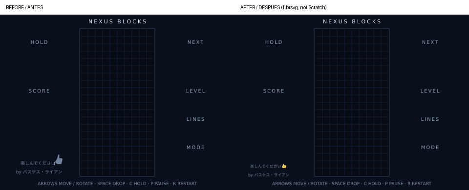
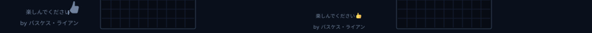

# NEXUS BLOCKS — Auditoría independiente

Fecha: 21 de octubre de 2026 (Asia/Tokyo). **Veredicto integral: INCONCLUSIVE.**

## 1. Resumen ejecutivo

Se corrigió exclusivamente la firma de ambos fondos y se reconstruyó el `.sb3`. El resto de `project.json` es idéntico al artefacto de partida, salvo los metadatos de los dos fondos; los otros recursos empaquetados son idénticos byte a byte. No se modificaron mecánicas, sonidos, reglas de puntuación, HUD, controles ni menús.

Las pruebas existentes y las comprobaciones adicionales completadas aprobaron sus aserciones. Se reprodujeron cuatro comportamientos defectuosos o inconsistentes, confirmados tanto en el intérprete de bloques como en el motor oficial. Los cuatro también se reproducen en el artefacto de `main`: no son regresiones introducidas por la firma. No se corrigieron.

La aceptación integral queda **inconclusa**: el navegador disponible rechaza el editor oficial por falta de WebGL; el motor Node no tiene renderer ni audio. Se verificó visualmente el emoji y la distribución de los fondos mediante renderizado SVG independiente, pero no se acredita su aspecto final dentro de Scratch ni reproducción auditiva. No se jugó visualmente durante esta auditoría.

## 2. Rama y commit auditados

| Elemento | Identificación |
| --- | --- |
| Repositorio | `Dracalight/Blocks` |
| Rama requerida, base de trabajo | `feat/nexus-blocks-credits-sfx` |
| Commit base verificado | `7da0c6801bdef4b72b84aa4b0ff5b7da66cdfc1d` |
| Rama independiente publicada | `audit/nexus-blocks-independent-local` |
| Commit publicado en GitHub | `52768986fd349432fc166730443ed16f61436be2` |
| `main`, solo comparación | `cb3bf7f53a323c948dbf458ee577a35e32e008af` |
| SHA-256 SB3 antes | `943d8560392b80c5d20546b3eb38ae2a5d64c91b535a3ea3583a5c9467ce2164` |
| SHA-256 SB3 final | `697bd5dc39f64dc5cd76872654b399b5c430d3e716bdf85a2e74db8e20fc53ee` |

El trabajo se publicó el 22 de octubre de 2026 en la rama independiente `audit/nexus-blocks-independent-local`. El commit remoto `52768986fd349432fc166730443ed16f61436be2` conserva el mismo árbol que el commit local `cf5e6237233a26963bd853351f30f7e1529b63fd`; GitHub generó otro SHA al crear el commit con su API. La rama base `feat/nexus-blocks-credits-sfx` y `main` permanecen intactas. No se creó PR ni se fusionaron cambios. `audit-evidence/remote-refs.txt` es la instantánea de refs tomada antes de publicar.

Se inspeccionaron el generador completo, el validador/intérprete, los dos puntos de entrada de pruebas, paquete y lockfile, los activos del SB3 y WAV 07–13, README, CHANGELOG y documentos de arquitectura, controles, pruebas y versionado. Los resultados históricos y `docs/gameplay.png` son contexto previo, no evidencia de una partida actual.

Comparación con main: la rama base incorpora firma, siete WAV, nivel cada diez líneas, selección de sonidos y latch de aviso. El diff íntegro está en `audit-evidence/main-to-branch.diff`. La progresión de niveles es un cambio funcional previo de esa rama; no se alteró en esta misión.

## 3. Cambios visuales autorizados

| Elemento | Antes | Después |
| --- | --- | --- |
| Primera línea | x=42, y=308, 9 px | x=32, y=314, 8 px |
| Segunda línea | centro x=80, y=326, 9 px | centro x=70, y=332, 8 px |
| Pulgar | dos trazados artesanales monocromáticos | emoji estándar Twemoji U+1F44D a color, 9×9 px |

Texto: `楽しんでください👍` y `by バスケス・ライアン`. Conserva sans-serif, color `#70829D`, peso normal y escenario de 480×360. El emoji ocupa x=97..106, y=306..315; el texto japonés precede al emoji. La segunda línea queda por encima de las instrucciones, cuya línea base sigue en y=350.

Se usa el recurso original Twemoji v14.0.2, Twitter, Inc. y otros colaboradores, bajo CC BY 4.0. Se conservaron el SVG fuente, la licencia y la atribución en `assets/credits/`; ambos fondos llevan también una descripción SVG no visible con atribución y enlaces. No es un icono redibujado: son los trazados originales del emoji estándar, escalados sin alterar su forma o color. La incrustación nativa evita descargas, fuentes emoji, imágenes externas o sprites adicionales.

Solo se modificaron `tools/build_sb3.py`, `tools/validate_sb3.py` (aserciones específicas de firma) y el SB3; se añadieron el recurso/licencia de créditos y los documentos/scripts de auditoría. Las pruebas originales de gameplay y el paquete npm permanecen intactos.

## 4. Comparación visual antes y después

Renderizado independiente con Sharp/librsvg y fuente Noto Sans CJK JP instalada únicamente para la inspección. No se cambió la fuente del juego ni se incluyó esa fuente en el SB3.






Se inspeccionaron ambos resultados: emoji amarillo reconocible, letras japonesas legibles, proporciones discretas y separación respecto al pie. La diferencia de píxeles queda dentro de la región de firma x=0..145, y=285..337; fuera de esa región no cambia ningún píxel bajo el mismo renderer. La caja efectiva de diferencia fue (28,287)-(128,334). Esto acredita la modificación acotada de los fondos, no el renderer de Scratch ni la interfaz animada completa.

La primera prueba con CairoSVG produjo cajas de sustitución para japonés por sus límites de fallback. Se descartó como validación visual y se sustituyó por librsvg; el juego no fue alterado para compensar una limitación del renderer de auditoría.

## 5. Pruebas de Scratch

Se abrió `https://scratch.mit.edu/projects/editor/` en dos entornos: el navegador inicial y un Chrome remoto. Ambos devolvieron **“Your Browser Does Not Support WebGL”** y **“This technology is needed for Scratch 3.0 to run.”** La segunda comprobación se conserva en `audit-evidence/cloud-browser-webgl.txt`. No fue posible importar ni jugar visualmente en el editor. El navegador local tampoco tenía instalado el binario de Chromium que Playwright requiere (`audit-evidence/local-browser-attempt.txt`). No se cambió ninguna protección o configuración del navegador.

El proyecto sí se cargó con `scratch-vm 5.0.300` y `scratch-storage 6.2.1`, ejecutando sus bloques reales. Los avisos de falta de renderer/audio se conservan completos. Carga y ejecución del motor aprobadas; importación gráfica en editor y escucha pendientes.

## 6. Resultados de pruebas automáticas

| Comando o comprobación | Resultado | Evidencia |
| --- | --- | --- |
| `python tools/build_sb3.py` | PASS | `audit-evidence/build.log` |
| `python tools/validate_sb3.py` | PASS | `audit-evidence/validate.log` |
| `python tools/test_sb3.py` | PASS | `audit-evidence/test-sb3.log` |
| `npm ci --ignore-scripts` | PASS | `audit-evidence/npm-ci.log` |
| `npm test` | PASS | `audit-evidence/npm-test.log` |
| Reconstrucción independiente | idéntica byte a byte | `audit-evidence/reproducible-build.log` |
| Casos adicionales, bloques | PASS; hallazgos reproducidos | `audit-evidence/independent.log` |
| Fixtures adicionales, VM oficial | PASS; hallazgos reproducidos | `audit-evidence/official-fixtures.log` |
| Diferencia visual acotada | PASS con renderer independiente | `audit-evidence/render.log` |

Entorno: Python 3.12.14, Node v24.19.0, npm 11.9.0. El SB3 contiene 50 entradas ZIP, 49 referencias de activos y 1.221 bloques en cuatro targets. Se validaron hashes, XML, PCM WAV, referencias y procedimientos; no faltan recursos. No se detectaron bloques desconectados al recorrer los grafos desde los hats y expandir llamadas a procedimientos. Los hats de broadcast se toman como raíces: esta comprobación no prueba que cualquier condición interna se active en una partida natural.

Las comprobaciones adicionales constatan que todos los bloques, variables, listas, sonidos y targets ajenos a los metadatos de fondos son idénticos al proyecto anterior. La prueba de firma compara los trazados incrustados con el archivo estándar vendorizado y comprueba tamaño y coordenadas.

### Sonidos

Los siete WAV son PCM mono, 16 bits, 44.100 Hz, no silenciosos, con duraciones y hashes en `audit-evidence/sfx-metadata.json`. Ninguno alcanza el máximo absoluto de PCM en los archivos inspeccionados. No se evaluó su calidad auditiva ni la mezcla con otros sonidos.

| Archivo | Evento comprobado | Resultado del despacho lógico |
| --- | --- | --- |
| `07_line_clear_1.wav` | una línea | una activación |
| `08_line_clear_2.wav` | dos líneas | una activación |
| `09_line_clear_3.wav` | tres líneas | una activación |
| `10_tetris_4.wav` | cuatro líneas | una activación |
| `11_chaos_warning.wav` | entrada en aviso de basura | una activación aunque se repita Tick |
| `12_level_up.wav` | cruce de múltiplo de diez líneas | una activación por transición |
| `13_game_start.wav` | Enter desde menú y entrada de inicio | una activación; Enter mantenido no duplica |

Se probaron 400 combinaciones de 0..99 líneas previas y limpiezas de 1..4, comprobando `Nivel = 1 + floor(Lineas/10)` y ausencia de segundo sonido al volver a revisar un tablero vacío. La VM oficial verificó además las transiciones 10,20,30,100. Se conserva la puntuación de la limpieza con el nivel previo. La instrumentación oficial registra el despacho de `sound_play`, no audio escuchado.

## 7. Resultado de partidas y mecánicas

**No hubo partidas visuales ni intervención humana de juego en esta sesión.** Hubo ejecución headless del planificador oficial, partidas simuladas mediante procedimientos del SB3 y fixtures artificiales para estados extremos.

La prueba oficial deja cada modo 20,1 segundos sin entrada, observa descensos/fijaciones reales del motor, verifica puntuación cero por gravedad y ejercita pausa/reanudación, flechas, giro, Hold mantenido, hard/soft drop, reinicio, selección de modos, eventos y basura. Las medianas observadas fueron NORMAL 0,662, HARD 0,308 y CHAOS 0,245 s/fila (1,3,5 fijaciones respectivamente); constan en `npm-test.log`; son medidas del motor headless, no FPS gráficos ni rendimiento de iPad.

Pruebas adicionales:

- 28.224 comparaciones de colisión frente a un oráculo de celdas: siete piezas, cuatro orientaciones, límites, techo, suelo y tableros con obstáculos.
- 2.100 giros consecutivos de las siete piezas, comprobando que toda posición resultante sea válida. Las pruebas heredadas cubren wall kick y giro bloqueado entre obstáculos. No se exige SRS: el juego tiene seis candidatos propios, conservados.
- 700 extracciones en 100 bolsas completas, sin repeticiones indebidas dentro de cada bolsa fuera del sesgo Chaos.
- NEXT se transfiere a pieza activa; Hold vacío, intercambio, limitación por turno y colisión de aparición están cubiertos. NB-AUDIT-001 y 003 registran inconsistencias concretas.
- Limpiezas 1/2/3/4, puntuación base, caída suave/instantánea, progresión y combos se inspeccionaron y probaron con el código real. El multiplicador Chaos está inicializado a 1 y no hay una mecánica activa que lo cambie; no se declara una función de multiplicación adicional.
- Chaos: alternancia de DIFFICULT PIECES/SPEED BURST, sesgo S/Z, aceleración, aviso y basura. El sesgo usa sustitución de próximas extracciones; 7-bag estricto no aplica durante esa ventana, por diseño. NB-AUDIT-002 afecta a eventos solapados.

El bucle principal serializa entrada y física. Los hats de UI y efectos se ejecutan aparte, por lo que el intérprete Python —que procesa broadcasts de forma síncrona— no basta para acreditar ausencia de todas las carreras; se complementó con la VM oficial. Los procedimientos de fuente sin refresco no garantizan una frecuencia gráfica determinada.

## 8. Estrés y secuencias reproducibles

| Escenario | Cobertura y resultado |
| --- | --- |
| Bot por procedimientos | 900 turnos intentados; 896 fijaciones, 69 reinicios por top-out, tres modos; tablero siempre de 200 celdas válidas |
| Entradas oficiales | 20 ciclos pulsar/mantener dos lecturas/soltar para cada una de ocho teclas, 160 ciclos; latches liberados correctamente |
| Teclas sostenidas | la suite oficial comprueba Hold y Space sostenidos sin doble acción; desplazamiento y caída repetida cubiertos |
| Reloj con bot | 180 s simulados acumulados por modo, 5.400 ticks en total y 24 reinicios; no equivalen a sobrevivir tres minutos sin perder |
| Pausa en superficie | diez segundos simulados congelan reloj y bloqueo; tras reanudar se fija después del tiempo restante |
| Tablero casi lleno | 100 ataques de basura, 50 top-outs esperados; no cambia la longitud del tablero |
| Reloj Chaos prolongado | fixture de 600 s lógicos con limpieza artificial del tablero cada segundo; 69 eventos, 41 avisos, piso de 0,07 s; `clock-stress.log` |

El fixture prolongado usa ayuda explícita para sostener el reloj y alcanzar ataques/eventos naturales; no es una partida ganada ni una medición de diez minutos de rendimiento real. Sus sonidos se cuentan como despachos lógicos.

Semillas: 20261021 en `independent.py`, 9191 en `long-stress.py`. Este último guarda las entradas explícitas, orden y ticks en `long-stress-inputs.json`. Cada bug tiene un fixture determinista en `independent.py` y `official-fixtures.cjs`. `baseline-repro.py` ejecuta los mismos casos contra main y la rama original.

## 9. Bugs confirmados

Los cuatro se observaron en el motor oficial y se reprodujeron también en los artefactos originales de main y de la rama obligatoria. Ninguno fue corregido. Las severidades reflejan impacto de juego/presentación, sin CRITICAL ni HIGH confirmados.

### NB-AUDIT-001 — LOW — Game Over duplicado tras Hold vacío

**Componente:** `Guardar_Hold`, `Generar_Nueva_Pieza`; `tools/build_sb3.py`, zona de líneas 1299–1331 y 1713–1748. Definiciones Scratch: `mot_blk_717` y `mot_blk_391`.

**Reproducción:** iniciar; Hold vacío (`Pieza_Guardada=0`), próxima O (`Siguiente_Pieza=2`), activa bajada a fila 10; ocupar la celda de aparición (fila2,col5, índice Python14); ejecutar Hold.

**Esperado:** GAMEOVER y un único despacho de `Sonido_GameOver`.

**Observado:** GAMEOVER con secuencia `Sonido_Hold, Sonido_GameOver, Sonido_GameOver`. Confirmado por el intérprete y la traza del primitivo oficial, sin afirmar dos sonidos audibles.

**Causa confirmada:** spawn emite Game Over y el control posterior de Hold vuelve a comprobar la misma colisión y a emitirlo.

**Propuesta:** una única transición centralizada o evitar la segunda emisión si spawn ya cambió el estado. Validar ambos caminos de Hold antes de aplicar.

### NB-AUDIT-002 — MEDIUM — Aviso de basura interrumpe el efecto Chaos activo

**Componente:** `Tick` / `Actualizar_Velocidad_Y_Caos`; zona de líneas 1115–1132 y 1845–1857; definición Tick `mot_blk_1138`.

**Reproducción:** CHAOS, reloj23,1, `Evento_Caos=SPEED BURST`, `Evento_Fin=30`, `Proximo_Ataque=25`, `Proximo_Evento=100`; ejecutar Tick. Es un fixture de solapamiento, no una secuencia natural de teclas.

**Esperado según la duración documentada:** mantener el efecto hasta su deadline y mostrar el aviso sin cancelar su física, o documentar explícitamente que el ataque lo sustituye.

**Observado:** `Evento_Caos=GARBAGE INCOMING` antes del deadline; la velocidad pasa aproximadamente de0,10192 a0,2038 s/fila. También se pierde el sesgo de piezas si la variable contenía DIFFICULT PIECES. El ataque finalmente pone NONE y no restaura el efecto pendiente.

**Causa confirmada:** la misma variable representa simultáneamente el modificador físico y el mensaje de aviso. El alcance exacto de la prioridad deseada debe ratificarlo el OWNER; el comportamiento y la contradicción con los siete segundos documentados sí son reproducibles.

**Propuesta:** separar aviso/estado del ataque y modificador vigente, preservando UI y reglas hasta autorización expresa.

### NB-AUDIT-003 — LOW — Hold con pieza almacenada hereda gravedad anterior

**Componente:** `Guardar_Hold`, `Reloj_Caida`; zona de líneas 1734–1746 y 1859. Definición `mot_blk_717`.

**Reproducción:** NORMAL, Hold contiene O, activa en fila10; `Tiempo_Juego=10`, `Reloj_Caida=9,36`; intercambiar y avanzar Tick20 ms en intérprete. En oficial se usa reloj9,34 para superar inequívocamente el umbral.

**Esperado por consistencia con Hold vacío/spawn:** la pieza colocada de nuevo en fila2 recibe un periodo de gravedad completo, salvo que se decida expresamente conservar el anterior.

**Observado:** desciende a fila3 en el primer Tick; el Hold vacío llama a spawn y reinicia ese reloj, el intercambio no. El periodo nominal es650 ms. El reset de bloqueo sí ocurre en ambos.

**Causa confirmada:** falta una asignación de `Reloj_Caida=Tiempo_Juego` en el camino de intercambio. La inconsistencia está confirmada; si se pretende ese diseño, debe documentarse y dejar de considerarse defecto.

**Propuesta:** acordar una sola política de temporización para Hold y añadir una regresión que compare ambos caminos.

### NB-AUDIT-004 — LOW — Top-out por basura sin sonido de Game Over

**Componente:** `Garbage_Attack`; zona de líneas 1802–1815, definición `mot_blk_810`.

**Reproducción:** iniciar, ocupar cualquier celda de la primera fila, ejecutar ataque de basura.

**Esperado:** la misma señal de Game Over que en colisión de spawn/Hold, una vez.

**Observado:** GAMEOVER y actualización de UI, sin despacho de `Sonido_GameOver`. La traza oficial queda vacía. El sonido de aviso del ataque, si lo precede, no es la señal de derrota.

**Causa confirmada:** el procedimiento cambia el estado por top-out o colisión sin llamar al sonido final.

**Propuesta:** unificar los caminos de transición a derrota, evitando duplicaciones como NB-AUDIT-001. No cambiar reglas ni activos 07–13 sin autorización.

## 10. Bugs potenciales y aspectos no concluyentes

**NB-AUDIT-005 — LOW, potencial — puntuaciones enormes:** el número del SCORE se estampa de derecha a izquierda con paso11 y sin ancho máximo; una puntuación de once o más dígitos podría recortar los primeros dígitos fuera del escenario. Se identificó estáticamente en `Dibujar_Numero`, pero no se validó visualmente ni se alcanzó en juego natural. No se afirma un defecto visual confirmado; evaluar con renderer real antes de limitar la puntuación o tocar HUD.

No se detectó corrupción de índices ni colisiones ilegales en los casos cubiertos. Esto no demuestra ausencia de cualquier bug. Sin renderer no se cierra el riesgo de sincronización visual de overlays, cambio rápido de fondos o animaciones tras reiniciar. Sin audio no se cierra solapamiento auditivo, latencia o calidad de mezcla. Sin iPad físico no se cierra foco/teclado/Safari.

## 11. Limitaciones del entorno

- Editor oficial inaccesible funcionalmente por falta de WebGL; sin partida ni importación gráfica nueva.
- VM oficial sin renderer/audio: ejecuta lógica, carga estructuras y despacha primitivas, pero no dibuja ni permite escuchar.
- Render de fondos con librsvg independiente; puede diferir de Scratch en fuentes y antialiasing. El emoji evita fuentes, pero falta la comprobación final dentro del editor.
- Fixtures alteran variables/listas solo en instancias de prueba; no alteran el SB3 ni demuestran alcanzabilidad natural de todos los estados inyectados.
- El intérprete Python comparte parte de la infraestructura de pruebas del repo; por eso se añadieron oráculo de colisiones, comparaciones byte a byte y reproducciones oficiales independientes. No se basa el veredicto solo en sus aserciones.
- No se hizo auditoría de vulnerabilidades con cobertura garantizada de todos los paquetes transitivos. npm es infraestructura de desarrollo y no se empaqueta en el juego.

## 12. Recomendaciones y reproducción

Primero verificar el SB3 adjunto en un Scratch con WebGL y sonido: ambos fondos, emoji a tamaño real, instrucciones, Enter, cuatro tipos de limpieza, transición de nivel y aviso. Después ratificar prioridades de eventos Chaos y reloj Hold; autorizar un parche separado para los defectos acordados.

Reproducción desde la raíz de una copia del commit base con el parche aplicado y dependencias instaladas:

```sh
python tools/build_sb3.py
python tools/validate_sb3.py
python tools/test_sb3.py
npm ci --ignore-scripts
npm test
python audit-evidence/independent.py
node audit-evidence/official-fixtures.cjs
python audit-evidence/long-stress.py
python audit-evidence/clock-stress.py
python audit-evidence/score-fixtures.py
python audit-evidence/baseline-repro.py
```

Para regenerar imágenes: instalar Pillow y Sharp, disponer de Noto Sans CJK JP en el sistema y ejecutar `python audit-evidence/render.py`. Estas son dependencias de evidencia, no del juego. Se incluyen SVG y PNG ya generados.

El paquete de entrega contiene SB3 corregido, parche binario aplicable al commit base, recursos/licencia, informe, scripts, logs y artefactos base para reproducción. `git apply --check signature-only.patch` debe ejecutarse en una copia limpia del commit7da0c68; luego `git apply signature-only.patch`. El parche no corrige ningún bug de gameplay.

## 13. Veredicto técnico final

**INCONCLUSIVE para aceptación integral.** La modificación de firma está implementada y verificada estructuralmente y mediante render de fondos; las pruebas automáticas aprobadas no muestran regresión de mecánicas. Cuatro hallazgos reproducidos permanecen abiertos y un riesgo adicional es potencial. Falta aceptación visual y auditiva en Scratch real. No se declara el juego libre de errores ni la corrección completamente validada en el dispositivo final.
